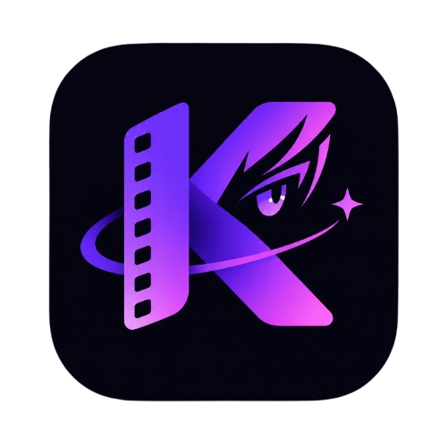

<p align="center">
  
</p>

# Kiroku — Frontend

> **Plataforma web de seguimiento y reseñas de anime.**  
> Cátedra: **Programación III** — INSPT  
> Comisión: **3-601 TM** | Grupo: **LOTUS**  
> Backend desplegado en Render: [https://backend-grupo-lotus.onrender.com](https://backend-grupo-lotus.onrender.com)

---

## 📖 Descripción del Proyecto

**Kiroku** (*記録* — registro / memoria) es una aplicación web interactiva desarrollada con **React, Vite y Tailwind CSS** que permite a los usuarios llevar un registro organizado de sus series de anime, marcar su progreso capítulo a capítulo, calificar títulos, publicar reseñas comunitarias y consultar métricas analíticas calculadas por MongoDB.

El frontend consume de forma completa los servicios proporcionados por la **API REST independiente desarrollada en el repositorio de backend**, manejando autenticación stateless mediante **JWT**, control de acceso basado en roles (**STD** y **ADMIN**) y diseño **100% responsive**.

---

## 🛠️ Tecnologías y Librerías Utilizadas

A continuación se detalla cada una de las librerías que integran el proyecto y su propósito específico (según consigna de evaluación):

### Dependencias de Producción (`dependencies`):
* **`react` (^18.3.1):** Biblioteca núcleo para la construcción de la SPA (Single Page Application) mediante componentes declarativos, gestión de estado con hooks (`useState`, `useEffect`) y reconciliación de DOM virtual.
* **`react-dom` (^18.3.1):** Provee el paquete de renderizado para conectar los componentes de React con el Document Object Model (DOM) del navegador mediante `createRoot`.
* **`lucide-react` (^1.16.0):** Conjunto integral de iconografía vectorial SVG modular, accesible y optimizada por tree-shaking para representar acciones interactivas (búsqueda, estrellas, filtros, sesión, alertas, navegación).

### Dependencias de Desarrollo y Compilación (`devDependencies`):
* **`vite` (^6.0.7):** Bundler y servidor de desarrollo moderno que aprovecha ES Modules nativos para brindar recarga rápida en caliente (HMR - Hot Module Replacement) y compilación optimizada para producción con Rollup.
* **`@vitejs/plugin-react` (^4.3.4):** Plugin oficial de Vite que habilita Fast Refresh y transformación eficiente de código JSX mediante Babel.
* **`tailwindcss` (^3.4.17):** Framework de estilos utilitarios (utility-first) utilizado para diseñar una interfaz cinematográfica oscura, coherente y 100% responsive (móvil, tablet y escritorio).
* **`postcss` (^8.4.49):** Herramienta que procesa y transforma los estilos CSS modernos utilizando plugins.
* **`autoprefixer` (^10.4.20):** Plugin de PostCSS que añade automáticamente prefijos propietarios de proveedores (`-webkit-`, etc.) para asegurar compatibilidad cross-browser.

---

## 💻 Requisitos de Software Necesario

Para poder instalar, ejecutar y compilar este proyecto se requiere contar previamente con:
* **Node.js:** Versión `18.0.0` o superior (se recomienda versión LTS activa `20.x` o `22.x`).
* **npm:** Versión `9.0.0` o superior (incluido automáticamente con Node.js).
* **Navegador Web Moderno:** Chrome, Firefox, Edge, Safari o cualquier navegador con soporte nativo de ES6+.

---

## 🚀 Instalación y Puesta en Marcha

### 1. Clonar el repositorio
```bash
git clone https://github.com/imsteffy/frontend-grupo-LOTUS.git
cd frontend-grupo-LOTUS
```

### 2. Instalar dependencias
```bash
npm install
```

### 3. Configurar variables de entorno
Crea un archivo `.env` en la raíz del proyecto (puedes basarte en `.env.example`):
```env
# Conexión directa a la API REST de Kiroku desplegada en Render:
VITE_API_URL=https://backend-grupo-lotus.onrender.com/api

# O para desarrollo local contra tu servidor Express / Node:
# VITE_API_URL=http://localhost:3000/api
```

### 4. Modos de Ejecución

* **Modo Desarrollo (con HMR y acceso en red local):**
  ```bash
  npm run dev
  ```
  Inicia el servidor local en `http://localhost:5173`. Gracias al flag `--host` configurado en Vite, también muestra la IP de tu red para probar el comportamiento responsive directamente desde un teléfono móvil.

* **Modo Compilación para Producción:**
  ```bash
  npm run build
  ```
  Genera la carpeta optimizada y minificada `dist/` con todos los activos estáticos listos para desplegar.

* **Modo Vista Previa de Producción:**
  ```bash
  npm run preview
  ```
  Sirve localmente el bundle generado en `dist/` para validar el rendimiento y las rutas antes de subir a hosting.

---

## 🧩 Estructura del Proyecto y Responsabilidad de Carpetas

El árbol de directorios está organizado siguiendo el principio de separación de responsabilidades y modularidad:

```text
frontend-grupo-LOTUS/
├── public/                       # Activos estáticos públicos servidos directamente por el servidor
│   ├── favicon.png               # Ícono de pestaña del navegador
│   ├── kiroku_logo.png           # Logotipo oficial de la plataforma
│   ├── 404-sasuke.gif            # Animación temática para la vista 404
│   └── _redirects                # Regla de reescritura SPA para Netlify / Render Static Sites
├── src/                          # Código fuente de la aplicación React
│   ├── components/               # Componentes reutilizables de UI y layout
│   │   └── layout/
│   │       ├── Navbar.jsx        # Barra superior con avatar, menú responsive y branding
│   │       ├── Sidebar.jsx       # Barra lateral de navegación con drawer para celulares
│   │       └── Footer.jsx        # Pie de página institucional y créditos académicos
│   ├── views/                    # Vistas principales de la SPA (rutas de la aplicación)
│   │   ├── CatalogView.jsx       # Catálogo oficial de animes, filtros combinados y paginador
│   │   ├── LibraryView.jsx       # Biblioteca personal, tabs por estado y botón +1 capítulo
│   │   ├── ReviewsView.jsx       # Muro de reseñas comunitarias, calificación 1-10 y spoilers
│   │   ├── DashboardView.jsx     # Analítica de MongoDB: horas vistas, estados y rankings
│   │   ├── ProfileView.jsx       # Autenticación (Login / Registro) y edición de perfil
│   │   ├── AdminView.jsx         # Consola de administración (Series, Géneros y Usuarios)
│   │   └── NotFoundView.jsx      # Pantalla 404 para URLs no reconocidas
│   ├── services/
│   │   └── api.js                # Cliente HTTP centralizado (fetch, JWT Bearer y manejo de 401)
│   ├── App.jsx                   # Componente raíz, orquestador de rutas, modal y estado global
│   ├── main.jsx                  # Punto de entrada de React 18 (renderizado en #root)
│   └── index.css                 # Importación de Tailwind CSS y tipografía Plus Jakarta Sans
├── index.html                    # Documento HTML base de la SPA (Single Page Application)
├── package.json                  # Manifiesto del proyecto, dependencias y scripts de ejecución
├── postcss.config.js             # Configuración de PostCSS y Autoprefixer
├── tailwind.config.js            # Configuración de Tailwind CSS (colores oscuros y fuentes)
├── vercel.json                   # Reglas de reescritura para despliegue en Vercel
├── vite.config.js                # Configuración de Vite y del plugin de React
└── README.md                     # Documentación técnica completa del proyecto
```

---

## 📋 Matriz de Endpoints Consumidos por Módulo

| Módulo | Endpoint Backend | Método | Funcionalidad en Frontend |
| :--- | :--- | :--- | :--- |
| **Auth & Usuarios** | `/api/auth/login`<br>`/api/auth/registro`<br>`/api/usuarios/me`<br>`/api/usuarios`<br>`/api/usuarios/:id/rol`<br>`/api/usuarios/:id` | `POST`<br>`POST`<br>`GET/PUT`<br>`GET`<br>`PATCH`<br>`DELETE` | Iniciar sesión y guardar JWT.<br>Registro de nuevos usuarios.<br>Consulta y actualización de nombre/avatar.<br>Listado general de usuarios (Admin).<br>Promoción o cambio de rol STD/ADMIN.<br>Baja definitiva de cuentas de usuario. |
| **Catálogo de Animes** | `/api/animes`<br>`/api/animes/:id`<br>`/api/animes`<br>`/api/animes/:id`<br>`/api/animes/:id/generos`<br>`/api/animes/:id`<br>`/api/animes/importar-externo` | `GET`<br>`GET`<br>`POST`<br>`PUT`<br>`PATCH`<br>`DELETE`<br>`POST` | Listado con filtros dinámicos y paginación.<br>Ficha técnica modal con chips de géneros.<br>Alta manual de anime con multiselect.<br>Modificación completa de anime.<br>Anexar géneros sin pisar existentes.<br>Eliminación de anime del catálogo.<br>Ingesta asistida desde MyAnimeList/Jikan. |
| **Catálogo de Géneros** | `/api/generos`<br>`/api/generos`<br>`/api/generos/:id`<br>`/api/generos/:id` | `GET`<br>`POST`<br>`PUT`<br>`DELETE` | Selector dinámico en filtros y en formularios.<br>Alta de nuevo género oficial.<br>Renombrado en línea.<br>Baja con validación de conflictos (409). |
| **Biblioteca & Seguimientos** | `/api/seguimientos`<br>`/api/seguimientos`<br>`/api/seguimientos/:id`<br>`/api/seguimientos/:id/incrementar`<br>`/api/seguimientos/:id` | `GET`<br>`POST`<br>`PUT`<br>`PATCH`<br>`DELETE` | Pestañas: Todos, Viendo, Completado, etc.<br>Añadir anime a la biblioteca personal.<br>Actualizar estado o capítulo.<br>Botón `+1 Cap` con regla de autocompletado.<br>Quitar título de la biblioteca. |
| **Reseñas Comunitarias** | `/api/resenas/anime/:id`<br>`/api/resenas`<br>`/api/resenas/:id`<br>`/api/resenas/:id` | `GET`<br>`POST`<br>`PUT`<br>`DELETE` | Consultar opiniones de un anime.<br>Publicar reseña (nota 1-10 y spoiler).<br>Modificar texto y puntuación.<br>Eliminación por el autor o moderación Admin. |
| **Analítica & Rankings** | `/api/usuarios/me/estadisticas`<br>`/api/stats/rankings` | `GET`<br>`GET` | Horas totales (minutos/60) y géneros más vistos.<br>Top 10 mejor puntuados y más seguidos. |
