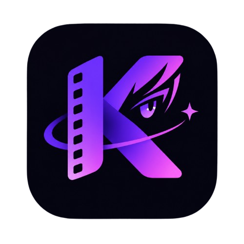

<p align="center">
  
</p>

# Kiroku — Frontend

> **Plataforma web de seguimiento y reseñas de anime.**  
> Cátedra: **Programación III** — INSPT  
> Comisión: **3-601 TM** | Grupo: **LOTUS**  
> Backend desplegado en Render: [https://backend-grupo-lotus.onrender.com](https://backend-grupo-lotus.onrender.com)

---

## 📖 Descripción del Proyecto

**Kiroku** (*記録* — registro / memoria) es una aplicación web interactiva desarrollada con **React, Vite y Tailwind CSS** que permite a los usuarios llevar un registro organizado de sus series de anime, marcar su progreso capítulo a capítulo, calificar títulos, publicar reseñas comunitarias y consultar métricas analíticas calculadas por MongoDB.

El frontend consume de forma completa los servicios proporcionados por la **API REST independiente desarrollada en el repositorio de backend**, manejando autenticación stateless mediante **JWT**, control de acceso basado en roles (**STD** y **ADMIN**) y diseño **100% responsive**.

---

## 🛠️ Tecnologías Utilizadas

* **React 18:** Biblioteca principal para la interfaz declarativa y componentes modulares.
* **Vite:** Herramienta de compilación ultrarrápida y servidor de desarrollo con HMR.
* **Tailwind CSS:** Framework de estilos utilitarios con paleta cinematográfica dark mode y soporte responsive.
* **Lucide React:** Iconografía vectorial moderna y consistente.
* **Fetch API & JWT:** Capa de comunicación HTTP con gestión segura de tokens en `localStorage`.

---

## 🚀 Instalación y Puesta en Marcha

### 1. Clonar el repositorio
```bash
git clone https://github.com/imsteffy/frontend-grupo-LOTUS.git
cd frontend-grupo-LOTUS
```

### 2. Instalar dependencias
```bash
npm install
```

### 3. Configurar variables de entorno
Crea un archivo `.env` en la raíz del proyecto (puedes basarte en `.env.example`):
```env
# Conexión directa a la API desplegada en Render:
VITE_API_URL=https://backend-grupo-lotus.onrender.com/api

# O para desarrollo local contra tu servidor Node:
# VITE_API_URL=http://localhost:3000/api
```

### 4. Ejecutar el servidor de desarrollo
```bash
npm run dev
```
La aplicación estará disponible en `http://localhost:5173`. Gracias a la configuración `server.host: true`, también estará accesible desde celulares u otros dispositivos conectados a la misma red local.

### 5. Compilar para producción
```bash
npm run build
```
Genera la carpeta optimizada `dist/` lista para ser desplegada en Vercel, Netlify o Render Static Sites.

---

## 🧩 Estructura y Módulos del Frontend

La aplicación se organiza siguiendo la repartición de responsabilidades del equipo:

```text
src/
├── components/
│   └── layout/
│       ├── Navbar.jsx       # Cabecera responsive con menú colapsable
│       └── Sidebar.jsx      # Navegación lateral y botón de sesión fijo
├── views/
│   ├── CatalogView.jsx      # Módulo 2: Catálogo oficial, filtros y paginación
│   ├── LibraryView.jsx      # Módulo 3: Biblioteca personal y avance +1 cap
│   ├── ReviewsView.jsx      # Módulo 3: Reseñas comunitarias (CRUD)
│   ├── DashboardView.jsx    # Módulo 3: Analítica de MongoDB y rankings
│   ├── ProfileView.jsx      # Módulo 1: Login, registro y edición de perfil
│   └── AdminView.jsx        # Módulos 1 y 2: Panel exclusivo de administración
├── services/
│   └── api.js               # Capa de consumo HTTP centralizada con JWT
├── App.jsx                  # Enrutador y estado global de la aplicación
└── index.css                # Directivas Tailwind y estilos base
```

---

## 📋 Matriz de Endpoints Consumidos por Módulo

| Módulo | Endpoint Backend | Método | Funcionalidad en Frontend |
| :--- | :--- | :--- | :--- |
| **Auth & Usuarios** | `/api/auth/login`<br>`/api/auth/registro`<br>`/api/usuarios/me`<br>`/api/usuarios`<br>`/api/usuarios/:id/rol`<br>`/api/usuarios/:id` | `POST`<br>`POST`<br>`GET/PUT`<br>`GET`<br>`PATCH`<br>`DELETE` | Iniciar sesión y guardar JWT.<br>Registro de nuevos usuarios.<br>Consulta y actualización de nombre/avatar.<br>Listado general de usuarios (Admin).<br>Promoción o cambio de rol STD/ADMIN.<br>Baja definitiva de cuentas de usuario. |
| **Catálogo de Animes** | `/api/animes`<br>`/api/animes/:id`<br>`/api/animes`<br>`/api/animes/:id`<br>`/api/animes/:id/generos`<br>`/api/animes/:id`<br>`/api/animes/importar-externo` | `GET`<br>`GET`<br>`POST`<br>`PUT`<br>`PATCH`<br>`DELETE`<br>`POST` | Listado con filtros dinámicos y paginación.<br>Ficha técnica modal con chips de géneros.<br>Alta manual de anime con multiselect.<br>Modificación completa de anime.<br>Anexar géneros sin pisar existentes.<br>Eliminación de anime del catálogo.<br>Ingesta asistida desde MyAnimeList/Jikan. |
| **Catálogo de Géneros** | `/api/generos`<br>`/api/generos`<br>`/api/generos/:id`<br>`/api/generos/:id` | `GET`<br>`POST`<br>`PUT`<br>`DELETE` | Selector dinámico en filtros y en formularios.<br>Alta de nuevo género oficial.<br>Renombrado en línea.<br>Baja con validación de conflictos (409). |
| **Biblioteca & Seguimientos** | `/api/seguimientos`<br>`/api/seguimientos`<br>`/api/seguimientos/:id`<br>`/api/seguimientos/:id/incrementar`<br>`/api/seguimientos/:id` | `GET`<br>`POST`<br>`PUT`<br>`PATCH`<br>`DELETE` | Pestañas: Todos, Viendo, Completado, etc.<br>Añadir anime a la biblioteca personal.<br>Actualizar estado o capítulo.<br>Botón `+1 Cap` con regla de autocompletado.<br>Quitar título de la biblioteca. |
| **Reseñas Comunitarias** | `/api/resenas/anime/:id`<br>`/api/resenas`<br>`/api/resenas/:id`<br>`/api/resenas/:id` | `GET`<br>`POST`<br>`PUT`<br>`DELETE` | Consultar opiniones de un anime.<br>Publicar reseña (nota 1-10 y spoiler).<br>Modificar texto y puntuación.<br>Eliminación por el autor o moderación Admin. |
| **Analítica & Rankings** | `/api/usuarios/me/estadisticas`<br>`/api/stats/rankings` | `GET`<br>`GET` | Horas totales (minutos/60) y géneros más vistos.<br>Top 10 mejor puntuados y más seguidos. |
