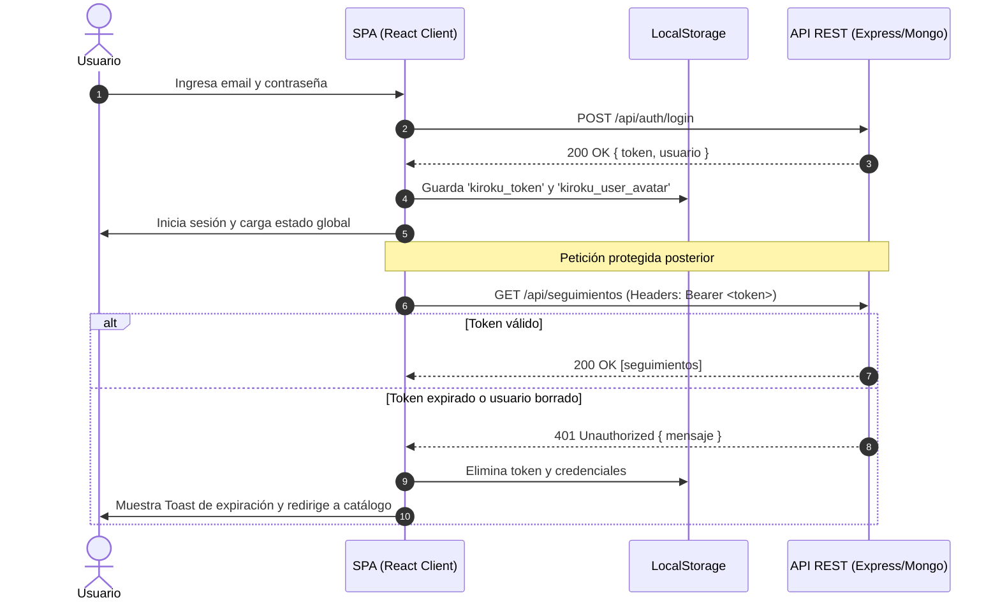

# Documentación Técnica Oficial — Kiroku Frontend

> **Cátedra:** Programación III — Instituto Nacional Superior del Profesorado Técnico (UTN INSPT)  
> **Comisión:** 3-601 TM | **Grupo:** LOTUS  
> **Aplicación:** SPA (Single Page Application) de Seguimiento y Reseñas de Anime  
> **Frontend Desplegado (Vercel):** [https://frontend-grupo-lotus.vercel.app](https://frontend-grupo-lotus.vercel.app)  
> **Backend API REST (Render):** [https://backend-grupo-lotus.onrender.com](https://backend-grupo-lotus.onrender.com)  

---

## 1. Introducción y Enfoque Arquitectónico

**Kiroku** (*記録* — registro / memoria) es una aplicación web interactiva desarrollada bajo el paradigma **SPA (Single Page Application)** con **React 18, Vite y Tailwind CSS**. La plataforma permite a los usuarios catalogar series de anime, gestionar su progreso capítulo a capítulo, calificar producciones, redactar reseñas comunitarias y consultar métricas analíticas calculadas por pipelines de agregación de MongoDB.

### Principios de Diseño:
1. **Desacoplamiento Total:** La aplicación frontend funciona como un cliente estático independiente que consume exclusivamente los endpoints expuestos por la API REST del backend.
2. **Navegación Fluida (SPA):** La navegación entre secciones no realiza recargas de página (*full page reloads*); utiliza la **HTML5 History API** (`pushState` y eventos `popstate`) para alternar vistas y sincronizar la URL de forma instantánea.
3. **Autenticación Stateless (JWT):** No se manejan sesiones del lado del servidor. El estado de autenticación se gestiona mediante tokens **JSON Web Tokens (JWT)** almacenados en el almacenamiento local del cliente (`localStorage`), inyectados en la cabecera HTTP `Authorization: Bearer <token>`.
4. **Diseño Mobile-First & 100% Responsive:** Interfaz cinematográfica en modo oscuro adaptada fluidamente para smartphones, tablets y pantallas de escritorio.
5. **Retroalimentación Visual Inmediata:** Estados de carga (*spinners*), botones deshabilitados para evitar dobles peticiones y un sistema centralizado de notificaciones flotantes (*Toasts*) ante éxitos o errores.

---

## 2. Requisitos de Entorno y Puesta en Marcha

### 2.1. Software Requerido
* **Node.js:** Versión `18.0.0` o superior (Recomendado LTS activa `20.x` o `22.x`).
* **npm:** Versión `9.0.0` o superior (incluido con la instalación de Node.js).
* **Navegador Web:** Navegador moderno con soporte nativo de ES Modules (Chrome, Firefox, Edge, Safari).

### 2.2. Instalación Paso a Paso

1. **Clonar el repositorio de código fuente:**
   ```bash
   git clone https://github.com/imsteffy/frontend-grupo-LOTUS.git
   cd frontend-grupo-LOTUS
   ```

2. **Instalar dependencias del proyecto:**
   ```bash
   npm install
   ```

3. **Configurar las variables de entorno:**
   Crear un archivo `.env` en la raíz del proyecto basándose en `.env.example`:
   ```env
   # URL base de la API REST del backend (Render o Local):
   VITE_API_URL=https://backend-grupo-lotus.onrender.com/api
   
   # Para desarrollo local contra el servidor Express local:
   # VITE_API_URL=http://localhost:3000/api
   ```

4. **Modos de Ejecución:**

   * **Servidor de Desarrollo (con Hot Module Replacement):**
     ```bash
     npm run dev
     ```
     Inicia el servidor local en `http://localhost:5173`. Gracias a la directiva `--host`, permite la conexión simultánea desde teléfonos móviles conectados a la misma red WiFi para pruebas de responsividad.

   * **Compilación para Producción:**
     ```bash
     npm run build
     ```
     Compila, minifica y optimiza el bundle en la carpeta `dist/`. Realiza tree-shaking y genera archivos estáticos listos para desplegar.

   * **Vista Previa de Producción Local:**
     ```bash
     npm run preview
     ```
     Ejecuta un servidor web local sirviendo directamente la carpeta `dist/` para validar el comportamiento real antes del despliegue.

---

## 3. Estructura del Proyecto y Responsabilidad de Componentes

La estructura de carpetas sigue una separación estricta por responsabilidades, componentes reutilizables y vistas de dominio:

```text
frontend-grupo-LOTUS/
├── docs/                                 # Documentación técnica, académica y guías de defensa
│   ├── DOCUMENTACION_TECNICA_FRONTEND.md # Documento técnico oficial (el presente archivo)
│   ├── GUIA_ESTUDIO_DEFENSA.md           # Guía de preguntas teóricas, conceptos y defensa oral
│   └── PROPUESTA.md                      # Propuesta académica del proyecto
├── public/                               # Activos estáticos servidos directamente
│   ├── favicon.png                       # Ícono de pestaña del navegador
│   ├── kiroku_logo.png                   # Logotipo oficial del proyecto Kiroku
│   ├── 404-sasuke.gif                    # Animación temática para la pantalla 404
│   └── _redirects                        # Regla SPA para Netlify, Cloudflare y Render Static
├── src/                                  # Código fuente modular en React 18
│   ├── components/                       # Componentes reutilizables organizados por dominio
│   │   ├── layout/                       # Componentes estructurales
│   │   │   ├── Navbar.jsx                # Cabecera con menú hamburguesa, branding y avatar
│   │   │   ├── Sidebar.jsx               # Navegación lateral (fija en escritorio, drawer en móviles)
│   │   │   └── Footer.jsx                # Pie de página institucional y créditos académicos
│   │   ├── common/                       # Componentes transversales reutilizables
│   │   │   ├── Toast.jsx                 # Notificación flotante de confirmaciones y alertas
│   │   │   └── RouteGuard.jsx            # Protección de vistas protegidas con pantalla 403
│   │   ├── anime/                        # Componentes del catálogo de series
│   │   │   └── AnimeDetailModal.jsx      # Modal con ficha técnica, chip de géneros y reseñas
│   │   └── admin/                        # Modales exclusivos del panel de administración
│   │       ├── AnimeFormModal.jsx        # Formulario de alta y edición de series
│   │       └── GenerosPatchModal.jsx     # Selector para anexar géneros sin pisar existentes (PATCH)
│   ├── views/                            # Vistas principales de la SPA (páginas)
│   │   ├── CatalogView.jsx               # Catálogo oficial, filtros combinados y paginación
│   │   ├── LibraryView.jsx               # Biblioteca personal, tabs por estado y botón +1 cap
│   │   ├── ReviewsView.jsx               # Reseñas comunitarias, notas 1-10 y control de spoilers
│   │   ├── DashboardView.jsx             # Métricas analíticas de MongoDB y rankings comunitarios
│   │   ├── ProfileView.jsx               # Inicio de sesión, registro de cuenta y edición de avatar
│   │   ├── AdminView.jsx                 # Consola de administración (Series, Géneros y Usuarios)
│   │   └── NotFoundView.jsx              # Pantalla 404 para rutas inexistentes
│   ├── services/
│   │   └── api.js                        # Cliente HTTP centralizado (fetch con JWT y manejo de 401)
│   ├── App.jsx                           # Orquestador raíz de la SPA, estado global y modal
│   ├── main.jsx                          # Punto de entrada de React 18 (createRoot en #root)
│   └── index.css                         # Directivas de Tailwind CSS y tipografía Plus Jakarta Sans
├── index.html                            # Documento HTML base con política no-referrer
├── package.json                          # Manifiesto de dependencias y scripts de ejecución
├── postcss.config.js                     # Configuración de PostCSS y Autoprefixer
├── tailwind.config.js                    # Configuración de tema oscuro y paleta cromática
├── vercel.json                           # Configuración de reescritura para hosting Vercel
├── vite.config.js                        # Configuración de Vite y plugin de React
└── README.md                             # Documentación introductoria del repositorio
```

---

## 4. Descripción de Librerías y Justificación Técnica

| Librería | Versión | Tipo | Justificación Técnica y Propósito |
| :--- | :---: | :---: | :--- |
| **`react`** | `^18.3.1` | Producción | Biblioteca fundamental para la construcción de interfaces declarativas basadas en componentes. Permite el manejo de estado reactivo mediante hooks (`useState`, `useEffect`) y renderizado eficiente a través de su DOM virtual. |
| **`react-dom`** | `^18.3.1` | Producción | Paquete de pegamento que conecta los árboles de componentes de React con el DOM nativo del navegador mediante la API moderna `createRoot`. |
| **`lucide-react`** | `^1.16.0` | Producción | Colección de íconos vectoriales SVG limpios, accesibles y modulares. Soportan *tree-shaking* automático, evitando sobrecargar el bundle final con íconos no utilizados. |
| **`vite`** | `^6.0.7` | Desarrollo | Herramienta de compilación ultrarrápida impulsada por Rollup y ES Modules nativos. Ofrece arranque instantáneo del servidor y reemplazo en caliente de módulos (HMR). |
| **`@vitejs/plugin-react`** | `^4.3.4` | Desarrollo | Plugin oficial para habilitar soporte completo de JSX y Fast Refresh en Vite. |
| **`tailwindcss`** | `^3.4.17` | Desarrollo | Framework de CSS utilitario (*utility-first*) que acelera el desarrollo de estilos consistentes en modo oscuro sin generar CSS redundante en producción. |
| **`postcss`** | `^8.4.49` | Desarrollo | Herramienta de procesamiento de hojas de estilo que transforma directivas modernas y optimiza el CSS compilado. |
| **`autoprefixer`** | `^10.4.20` | Desarrollo | Plugin de PostCSS que inyecta automáticamente los prefijos de proveedores propietarios (`-webkit-`, `-moz-`) para compatibilidad entre navegadores. |

---

## 5. Módulos Funcionales y Consumo de la API REST

### 5.1. Módulo de Autenticación, Usuarios y Perfil
* **Login y Registro:** Formulario interactivo con validaciones en cliente (`email` con formato válido, contraseña de al menos 6 caracteres y nombre obligatorio).
* **Gestión del JWT:** Al iniciar sesión o registrarse, el token recibido se almacena en `localStorage` (`kiroku_token`).
* **Edición de Perfil:** El usuario puede actualizar su nombre visible y su avatar mediante una URL HTTP/HTTPS. El avatar se propaga en tiempo real a la cabecera, la barra lateral y los comentarios de reseñas.
* **Cierre de Sesión:** Limpieza completa de credenciales en almacenamiento local y restablecimiento del estado global de la aplicación.

### 5.2. Módulo de Catálogo Oficial de Animes
* **Buscador Dinámico:** Búsqueda en tiempo real por título en español o título original japonés mediante expresiones regulares insensibles a mayúsculas/minúsculas (`$regex`).
* **Filtros Combinados:** Selección cruzada por **Género** (catálogo dinámico obtenido de `/api/generos`), **Estado de emisión** (*Finalizado*, *En emisión*, *Por estrenar*) y **Año de estreno**.
* **Paginación:** Navegación por páginas de 10 elementos calculada desde el servidor (`skip` y `limit`).
* **Ficha Técnica Modal:** Al hacer clic en una tarjeta, se despliega un modal con la información técnica completa, chips de géneros, sinopsis extendida y listado de reseñas comunitarias.

### 5.3. Módulo de Biblioteca Personal y Seguimiento
* **Pestañas de Estado:** Filtra los animes guardados del usuario en: *Todos*, *Viendo*, *Completado*, *Pendiente* y *Abandonado*.
* **Avance de Episodios (+1 Cap):** Botón de incremento directo que actualiza el progreso en MongoDB. Al alcanzar el número total de episodios del anime, transiciona automáticamente a estado *Completado*.
* **Retroceso Inteligente:** Al pulsar el botón de restar capítulo desde un anime *Completado*, el frontend omite el parámetro `estado` para permitir que la regla de negocio del backend lo devuelva automáticamente a *Viendo*.
* **Sincronización Bidireccional:** Al eliminar un título de la biblioteca, se notifica al catálogo para reactivar el botón de `+ Agregar`.

### 5.4. Módulo de Reseñas Comunitarias
* **Publicación de Opiniones:** Formulario con selector de calificación (1 al 10 estrellas), área de texto con límite de 2000 caracteres y casilla de verificación para advertencia de *Spoilers*.
* **Control de Acceso basado en Roles (RBAC):**
  - **Edición:** Reservada de forma exclusiva al autor original de la reseña.
  - **Eliminación:** Permitida al autor de la reseña o a un usuario con rol `ADMIN` (moderación comunitaria).
* **Destaque Visual de Administradores:** Las reseñas escritas por usuarios administradores se destacan con borde dorado, gradiente cálido y una insignia (*badge*) de corona dorada.

### 5.5. Módulo de Analítica y Rankings
* **Métricas Personales (MongoDB Aggregation Pipelines):**
  - Horas totales vistas calculadas en base a minutos por episodio (`horas = (episodios * 24) / 60`).
  - Distribución de animes por estado (*Viendo*, *Completado*, etc.).
  - Top de géneros favoritos calculados mediante `$lookup`, `$unwind` y `$sortByCount`.
* **Rankings Comunitarios:**
  - **Top Mejor Puntuados:** Animes con mayor calificación promedio, desempatados por cantidad de reseñas y orden alfabético.
  - **Top Más Seguidos:** Series con mayor cantidad de adiciones en bibliotecas personales.

### 5.6. Módulo de Consola de Administración (Admin)
* **Gestión de Series:** Alta manual de animes, edición de datos técnicos, eliminación y herramienta de ingesta asistida desde MyAnimeList/Jikan (`/api/animes/importar-externo`).
* **Taxonomía de Géneros:** Creación, edición de nombre y eliminación de géneros oficiales.
* **Gestión de Usuarios:** Listado de cuentas registradas, alternancia de roles (`STD` ↔ `ADMIN`) y eliminación de usuarios (protegida para evitar que un admin elimine su propia cuenta o usuarios con reseñas asociadas).

---

## 6. Seguridad, Manejo de Sesión y Ciclo de Vida del Token



### 6.1. Interceptor de Peticiones HTTP ([api.js](file:///C:/Users/Steff/Desktop/frontend-grupo-LOTUS/src/services/api.js))
La función central `apiRequest(endpoint, options)` encapsula todas las llamadas de red:
1. Extrae automáticamente el token de `localStorage`.
2. Si existe, inyecta la cabecera `Authorization: Bearer <token>`.
3. Si el servidor responde con **`401 Unauthorized`**, dispara el evento global `auth:unauthorized`, el cual limpia el almacenamiento local y notifica al usuario sin romper la interfaz.
4. Parsea las respuestas JSON de error del backend (`errorMsg = data?.mensaje || ...`) y las arroja como instancias de `Error` legibles para que las vistas puedan mostrarlas en Toasts.

### 6.2. RouteGuard para Vistas Privadas ([RouteGuard.jsx](file:///C:/Users/Steff/Desktop/frontend-grupo-LOTUS/src/components/common/RouteGuard.jsx))
La ruta `/admin` está envuelta por el componente de control de acceso. Si el usuario actual no posee `rol: "ADMIN"` (o es un visitante anónimo), el componente bloquea el renderizado y despliega una pantalla informativa de **Acceso Denegado (403)** con un botón de redirección segura al catálogo.

---

## 7. Responsividad y Tratamiento de Activos Externos

### 7.1. Navegación Móvil Adaptativa
* En pantallas con ancho menor a `1024px` (`lg` en Tailwind), la barra lateral se oculta y el encabezado muestra un botón de menú hamburguesa.
* Al hacer clic, la barra lateral emerge como un **Drawer flotante** con un telón semitransparente oscuro con efecto de desenfoque (*backdrop-blur*) y un botón de cierre `✕`.
* Al pulsar cualquier opción de navegación, el menú se repliega automáticamente para no obstruir la lectura.

### 7.2. Política de Referrer para CDNs de Anime (`no-referrer`)
Servidores externos como MyAnimeList y AniList implementan bloqueos de *hotlinking* si detectan la cabecera `Referer: http://localhost:5173`.  
Para evitar que las imágenes de portada se muestren rotas:
1. Se declaró la directiva global en [index.html](file:///C:/Users/Steff/Desktop/frontend-grupo-LOTUS/index.html):
   ```html
   <meta name="referrer" content="no-referrer" />
   ```
2. Se añadió el atributo `referrerPolicy="no-referrer"` en todas las etiquetas `` de la aplicación.
3. Se implementó un manejador de error `onError` en cada imagen que conmuta hacia un placeholder estilizado de alta disponibilidad (`placehold.co`) en caso de cualquier falla de red.

---

## 8. Despliegue en Servicios de Hosting

Dado que la aplicación es una SPA con enrutamiento del lado del cliente, cualquier recarga de página (F5) en una subruta (como `/catalogo` o `/biblioteca`) causaría un error 404 en el servidor web si no está configurada la regla de reescritura (*fallback to index.html*).

Para garantizar un despliegue inmediato en cualquier plataforma moderna, el proyecto incluye:

* **Vercel ([vercel.json](file:///C:/Users/Steff/Desktop/frontend-grupo-LOTUS/vercel.json)):**
  ```json
  {
    "rewrites": [
      {
        "source": "/(.*)",
        "destination": "/index.html"
      }
    ]
  }
  ```
* **Netlify / Render Static / Cloudflare Pages (`public/_redirects`):**
  ```text
  /*    /index.html   200
  ```

---

## 9. Conclusión

El frontend de **Kiroku** cumple rigurosamente con la totalidad de los requisitos pedagógicos y técnicos exigidos para la entrega final:
* Es una **SPA modular y responsive** desarrollada en React 18.
* Maneja **sesión con JWT** y roles **STD/ADMIN** con expiración limpia.
* Cuenta con **retroalimentación visual completa** (toasts, spinners, disabled).
* Valida los formularios en cliente antes de interactuar con el backend.
* Posee una arquitectura de carpetas prolija, sin componentes monolíticos, con código mantenible y documentación técnica completa lista para la exposición ante el tribunal examinador.
